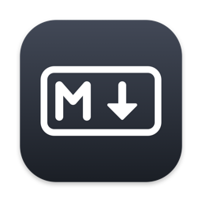
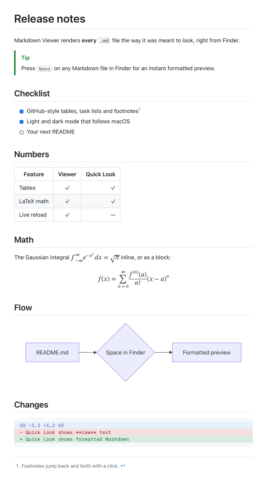
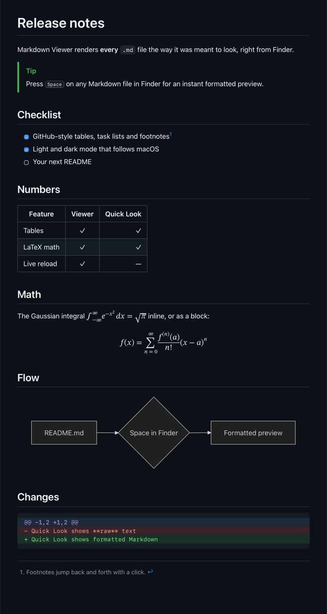

<p align="center">
  
</p>

<h1 align="center">Markdown Viewer for macOS</h1>

<p align="center">
  Open and <b>Quick Look</b> (spacebar) preview <code>.md</code> files on your Mac fully formatted, instead of as plain text.<br>
  Native app + Finder Quick Look extension · GitHub-flavored Markdown · LaTeX math · Mermaid diagrams · diffs · light &amp; dark mode
</p>

| Light | Dark |
|:-----:|:----:|
|  |  |

## Why

macOS shows Markdown as raw text: double-click a `README.md` and it opens in TextEdit, press Space in Finder and you get `#`, `**` and `|---|` instead of headings, bold text and tables. Markdown Viewer fixes both:

- **Double-click** any `.md` file → it opens formatted, in tabs, and reloads live while you edit it elsewhere.
- **Press Space** in Finder → the Quick Look preview is formatted too.

Everything runs locally. Nothing is uploaded, no account, no analytics.

## Install

Needs macOS 14 or later and the Xcode Command Line Tools (`xcode-select --install`). Xcode itself is not required.

```sh
git clone https://github.com/omarthailand2231/markdown-viewer-macos.git
cd markdown-viewer-macos
./scripts/build.sh --install
./scripts/doctor.sh
```

This builds `MarkdownViewer.app` into `~/Applications`, registers the Quick Look extension, and on first launch makes the app the default for `.md` files. To change the default later: Finder → select a `.md` file → Get Info → *Open with* → *Change All…*.

> [!NOTE]
> macOS only loads signed extensions, so the build script creates a self-signed **"Local Code Signing"** certificate in its own keychain (`~/Library/Keychains/dev-signing.keychain-db`) the first time it runs. It is used only to sign this app on your Mac. See [`scripts/setup-signing.sh`](scripts/setup-signing.sh).

If Finder still shows plain text after installing, reset Quick Look and relaunch Finder:

```sh
qlmanage -r && qlmanage -r cache && killall Finder
```

Then check that **Markdown Preview** is switched on in System Settings → General → Login Items & Extensions → Quick Look.

## What it renders

| Markdown | Supported |
|:---------|:---------:|
| Headings, paragraphs, emphasis, ~~strikethrough~~, `inline code` | ✓ |
| Links (inline, reference, autolinks, bare URLs), `#anchor` jumps to headings | ✓ |
| Images (local files are embedded, remote URLs load in the app) | ✓ |
| Tables with left / center / right alignment and empty cells | ✓ |
| Task lists `- [ ]` / `- [x]`, nested and ordered lists, custom start numbers | ✓ |
| Block quotes, nested quotes, GitHub callouts `> [!NOTE]` `[!TIP]` `[!IMPORTANT]` `[!WARNING]` `[!CAUTION]` | ✓ |
| Fenced and indented code blocks | ✓ |
| Footnotes `[^1]` with back-links | ✓ |
| LaTeX math: `$…$`, `$$…$$`, ` ```math `, `\(…\)`, `\[…\]` | ✓ |
| Mermaid diagrams in ` ```mermaid ` fences (flowchart, sequence, class, state, gantt, pie, …) | ✓ |
| Code changes in ` ```diff ` / ` ```patch ` fences, with added and removed lines colored | ✓ |
| Raw HTML (`<details>`, `<kbd>`, …) | ✓ |
| YAML front matter (shown as a muted block) | ✓ |
| Light and dark mode, following the macOS appearance live | ✓ |
| Syntax highlighting for other languages | not yet |

Math is written in TeX and rendered with [KaTeX](https://katex.org) to MathML, which WebKit draws natively, so equations look the same in the app and in Quick Look. Dollar amounts like "$5 and $10" stay plain text.

Mermaid diagrams are drawn once by [Mermaid](https://mermaid.js.org) in a hidden web view and embedded as SVG, in a light and a dark version, so they follow the system appearance like the rest of the page, in Quick Look too. A diagram with a syntax error falls back to its source code.

## Using the app

| Action | Shortcut |
|:-------|:--------:|
| Open a file | ⌘O |
| Edit the file in your text editor | ⌘E |
| Show the file in Finder | ⇧⌘R |
| Zoom in / out / actual size | ⌘= / ⌘- / ⌘0 |
| Reload | ⌘R |
| Print or save as PDF | ⌘P |

Links to other Markdown files open in the viewer, web links open in your browser, and `#heading` links scroll within the page. The app saves nothing: closing the last window quits it.

## How it works

```text
.md file ──► Apple's Markdown parser (AttributedString, CommonMark + GFM)
         ──► HTML built from the parser's block and inline intents
         ──► math spans rendered by KaTeX in JavaScriptCore → MathML
         ──► mermaid fences rendered by Mermaid in a hidden WKWebView → SVG (light + dark)
         ──► WKWebView (app, page scripts disabled)  or  Quick Look HTML preview (extension)
```

- `Sources/Shared/MarkdownRenderer.swift` turns Markdown into one HTML page with a GitHub-like stylesheet. Both the app and the extension use it, so they always look the same.
- `Sources/Shared/MathSupport.swift` finds math outside code, renders it once to MathML, and swaps it back in after parsing so Markdown never mangles TeX.
- `Sources/Shared/MermaidSupport.swift` renders Mermaid diagrams to SVG once per diagram and caches them.
- `Sources/App/` is a small AppKit app: one window per file, tabs, file watching for live reload.
- `Sources/QuickLook/PreviewProvider.swift` is a sandboxed, data-based Quick Look preview extension.
- `Vendor/katex/` (KaTeX 0.16.11) and `Vendor/mermaid/` (Mermaid 11.4.1) are the only third-party code, both MIT.

## Development

```sh
./scripts/test.sh                                   # 90 checks, including real Mermaid rendering
./scripts/snapshot.sh docs/demo.md out.png --dark   # render any .md to a PNG without opening a window
./scripts/build.sh --install                        # build, sign, install, register
./scripts/doctor.sh                                 # verify the install
./scripts/uninstall.sh                              # remove the app and extension
```

**AI agents:** [AGENTS.md](AGENTS.md) is a complete guide to installing, verifying, using, uninstalling and modifying Markdown Viewer on a user's Mac.

## FAQ

**How do I preview Markdown files with Quick Look on macOS?**
Install Markdown Viewer, select a `.md` file in Finder and press Space. The preview extension renders it as formatted HTML.

**How do I make `.md` files open formatted instead of in TextEdit or Xcode?**
Markdown Viewer sets itself as the default app for Markdown on first launch. You can also use the app menu → *Make Default for Markdown Files*.

**Does it render Mermaid diagrams in Quick Look?**
Yes. ` ```mermaid ` blocks become diagrams in both the app and the Finder preview, in light and dark mode.

**Does it render LaTeX math in Markdown?**
Yes, in both the app and Quick Look, using the same `$…$` / `$$…$$` syntax GitHub uses, plus `\(…\)` and `\[…\]` from ChatGPT-style answers.

**Does it work offline? Does it send my files anywhere?**
It works fully offline and never uploads anything. Remote images in a document are the only network requests, and only in the app window.

**Which macOS versions?**
macOS 14 Sonoma and later. Developed and tested on Apple silicon.

## License

[MIT](LICENSE). KaTeX and Mermaid are MIT-licensed, see [Vendor/katex/LICENSE](Vendor/katex/LICENSE) and [Vendor/mermaid/LICENSE](Vendor/mermaid/LICENSE).
