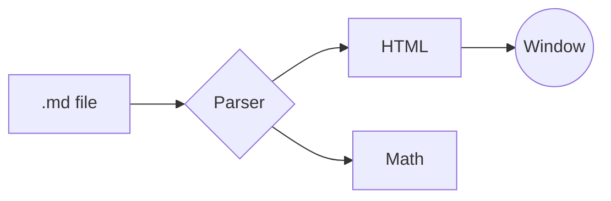
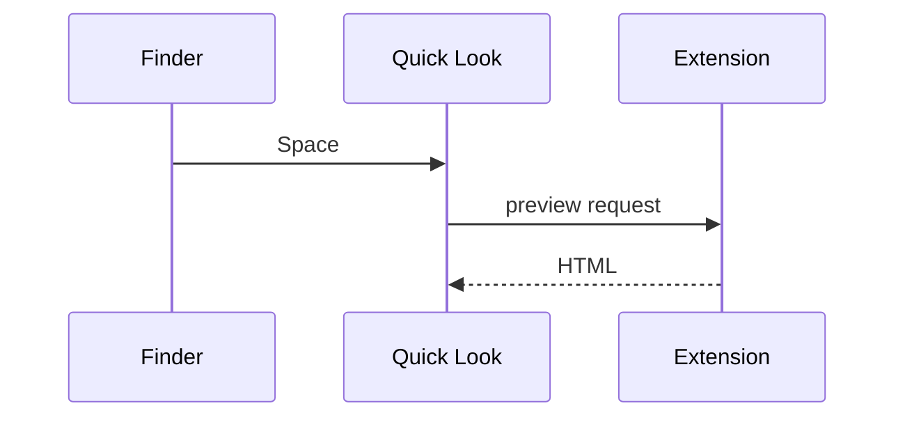

# Diagrams and code changes





```mermaid
this is not a valid diagram {{{
```

```diff
diff --git a/greeting.swift b/greeting.swift
index 3b18e51..a9c2f4d 100644
--- a/greeting.swift
+++ b/greeting.swift
@@ -1,4 +1,4 @@
 func greet(_ name: String) -> String {
-    return "Hello " + name
+    return "Hello, \(name)!"
 }

```
