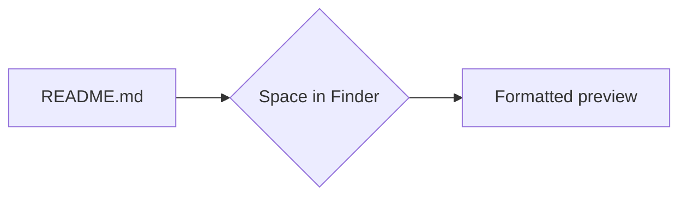

# Release notes

Markdown Viewer renders **every** `.md` file the way it was meant to look, right from Finder.

> [!TIP]
> Press <kbd>Space</kbd> on any Markdown file in Finder for an instant formatted preview.

## Checklist

- [x] GitHub-style tables, task lists and footnotes[^1]
- [x] Light and dark mode that follows macOS
- [ ] Your next README

## Numbers

| Feature        | Viewer | Quick Look |
|:---------------|:------:|-----------:|
| Tables         |   ✓    |          ✓ |
| LaTeX math     |   ✓    |          ✓ |
| Live reload    |   ✓    |          — |

## Math

The Gaussian integral $\int_{-\infty}^{\infty} e^{-x^2}\,dx = \sqrt{\pi}$ inline, or as a block:

$$
f(x) = \sum_{n=0}^{\infty} \frac{f^{(n)}(a)}{n!}(x-a)^n
$$

## Flow



## Changes

```diff
@@ -1,2 +1,2 @@
- Quick Look shows **raw** text
+ Quick Look shows formatted Markdown
```

[^1]: Footnotes jump back and forth with a click.
